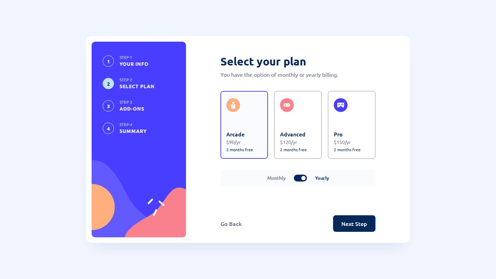

# Frontend Mentor - Multi-step form solution

This is a solution to the [Multi-step form challenge on Frontend Mentor](https://www.frontendmentor.io/challenges/multistep-form-YVAnSdqQBJ). Frontend Mentor challenges help you improve your coding skills by building realistic projects.

## Table of contents

- [Overview](#overview)
  - [The challenge](#the-challenge)
  - [Screenshot](#screenshot)
  - [Links](#links)
- [My process](#my-process)
  - [Built with](#built-with)
  - [Workflow](#workflow)
  - [What I learned](#what-i-learned)
  - [Continued development](#continued-development)
  - [Useful resources](#useful-resources)
  - [AI Collaboration](#ai-collaboration)
- [Author](#author)

## Overview

### The challenge

Users should be able to:

- Complete each step of the sequence
- Go back to a previous step to update their selections
- See a summary of their selections on the final step and confirm their order
- View the optimal layout for the interface depending on their device's screen size
- See hover and focus states for all interactive elements on the page
- Receive form validation messages if:
  - A field has been missed
  - The email address is not formatted correctly
  - A step is submitted, but no selection has been made

### Screenshot



### Links

- Live Site URL: [ounokoya.github.io/multi-step-form](https://ounokoya.github.io/multi-step-form/)

## My process

### Built with

- Semantic HTML5: one `<form>` holding every step, `fieldset` / `legend`, native radio buttons and checkboxes
- [Tailwind CSS v4](https://tailwindcss.com/) — design tokens in `@theme`, default palette removed, repeated groups as `@utility`
- Vanilla JavaScript, one ES module per responsibility (`steps.js`, `validation.js`, `pricing.js`)
- The browser's Constraint Validation API with custom messages
- Mobile-first layout: mobile < 768 px (fixed bottom bar), tablet 768–1023 px, desktop ≥ 1024 px
- Ubuntu served with the site through [Fontsource](https://fontsource.org/fonts/ubuntu)
- [Vite](https://vite.dev/) for the build, deployed on GitHub Pages from the `gh-pages` branch (`npm run deploy`)
- [Playwright](https://playwright.dev/), [axe-core](https://github.com/dequelabs/axe-core) and the W3C Nu validator for tests

### Workflow

Before any code, the design was analysed and rebuilt:

1. **Visual analysis in Excalidraw** — every screen measured in px, font sizes fitted against the JPGs in Chromium, inventory of all interactive elements, contrast checks → [`specs/visuel/`](./specs/visuel/)
2. **Penpot mockup and prototype** — library, 23 components with their states, 22 screens (including a tablet proposal), click-through prototype, visual thresholds calibrated per screen → [`specs/visuel/penpot/`](./specs/visuel/penpot/)
3. **Spec, then tests** — 27 Given/When/Then scenarios and the accessible names the tests rely on → [`specs/specifications/`](./specs/specifications/); the 58 Playwright tests were written before the code and checked to fail on the starter
4. **Decisions** — font loading, where the state lives, validation and the billing switch chosen among options → [`specs/adr/`](./specs/adr/)
5. **Code** — one commit per part (theme, layout, navigation, validation, pricing), tests run at each step → [`specs/analyse/`](./specs/analyse/) for the validation report

### What I learned

**The form is the state.** All steps live in one `<form>`; navigating only shows another section, so "Go Back" and "Change" keep every choice for free. The summary reads the values when step 4 opens:

```js
const data = new FormData(form)
const [planName, planPrice] = PLANS[data.get('plan')]
const addons = data.getAll('addons').map((key) => ADDONS[key])
```

**Native validation, custom messages.** The rules stay in the HTML (`required`, `type="email"`, a `pattern` for the phone); JavaScript only picks the message from `validity` and clears it as soon as its cause is gone:

```js
function causeOf(input) {
  if (input.validity.valueMissing) return 'required'
  return input.validity.valid ? null : 'format'
}
```

**A radio card that is still a real radio button.** A visually hidden (`sr-only`) radio could not be clicked by its centre, so the radio covers the whole card with `opacity: 0`: mouse, keyboard arrows and screen readers all go through the native input, and the card is styled with `:has(:checked)`.

**A switch without JavaScript for its state.** The billing toggle is `<input type="checkbox" role="switch">`; the knob is a radial gradient that moves with `background-position`, so the value is part of the form data.

### Continued development

- **Accessibility vs. pixel-perfect.** Several design colours were below WCAG thresholds and were changed: grey text (2.8:1 → 5.0:1), error text (4.0:1 → 4.9:1), field and card borders (1.4:1 → 3.3:1), "STEP 1" labels on the sidebar (3.4:1 → 4.6:1) and the Confirm hover (2.8:1 → 4.5:1). The selected plan also gets a 2 px border so it is not marked by colour alone.
- **Design inconsistencies.** The mobile yearly images highlight "Monthly" and show "Arcade (Monthly)" with yearly prices, and the monthly total has a "+": the code follows the logic (yearly label highlighted, "(Yearly)", no "+" on a total).
- **Visual comparison with the design files.** Screenshots differ from the Frontend Mentor JPGs by 1.4–2.2 % on desktop and 3.8–5.9 % on mobile, mostly text antialiasing at small sizes and the darker colours above.
- **No tablet design** was provided: the tablet layout (desktop structure in a 720 px card) is my own proposal.

### Useful resources

- [MDN — Client-side form validation](https://developer.mozilla.org/en-US/docs/Learn_web_development/Extensions/Forms/Form_validation) — `validity`, `novalidate` and custom messages.
- [MDN — FormData](https://developer.mozilla.org/en-US/docs/Web/API/FormData) — reading a whole form, including radio groups and checkboxes.
- [WAI-ARIA APG — Switch pattern](https://www.w3.org/WAI/ARIA/apg/patterns/switch/) — when a checkbox with `role="switch"` fits.

### AI Collaboration

I used **Claude (Claude Code)** as a pair, inside my own spec-driven workflow where I validated each step before the next one:

- **Planning**: Claude explored the challenge list with me (points and levels checked on Frontend Mentor) and wrote the plan, which I validated.
- **Design analysis and mockup**: Claude measured the JPG designs, drew the annotated Excalidraw analysis and built the Penpot mockup; I reviewed both and decided the contrast fixes, the tablet layout and the form rules.
- **Spec and tests**: written by Claude before any code, from the validated mockup.
- **Technical decisions**: Claude presented options with their trade-offs and I chose (Fontsource, form as state, native validation, checkbox switch).
- **Code**: written by Claude from the spec — I confirmed this split at the code lock — one commit per part, with the tests run at each step.

What worked well: tests written before the code gave a clear target, and calibrating the visual thresholds in Penpot made the pixel checks meaningful. What needed my decisions: the design's contrast issues and inconsistencies, the tablet layout and the validation rules.

## Author

- Frontend Mentor - [@ounokoya](https://www.frontendmentor.io/profile/ounokoya)
- GitHub - [@ounokoya](https://github.com/ounokoya)
